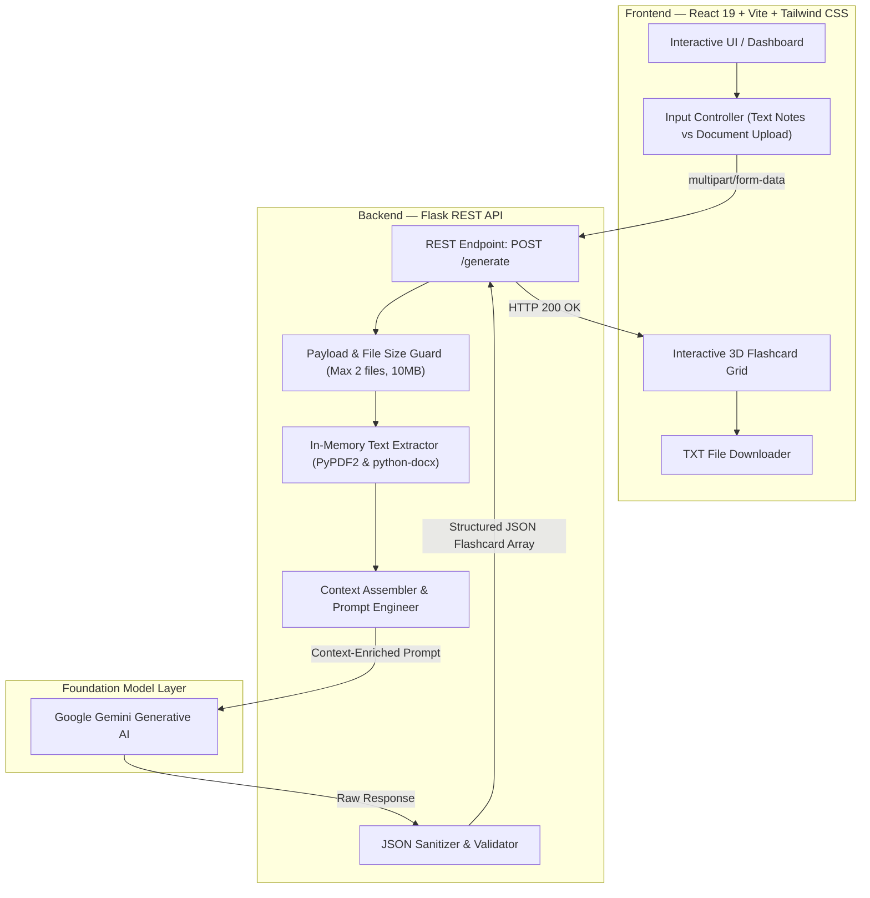

# FlashMind-AI ⚡

> **An intelligent, context-aware flashcard generation platform powered by Google Gemini AI, designed to automate active-recall study preparation directly from raw notes and enterprise documents.**

[](https://react.dev/)
[](https://vitejs.dev/)
[](https://tailwindcss.com/)
[](https://www.python.org/)
[](https://flask.palletsprojects.com/)
[](https://ai.google.dev/)
[](LICENSE)

---

## 📌 Overview

**FlashMind-AI** bridges the gap between passive reading and high-retention active recall. Designed for students, researchers, and professionals, it automates the tedious process of manual flashcard authoring by transforming unstructured text notes, lecture slides, and enterprise documents (PDF & DOCX) into targeted, high-yield question-and-answer decks in seconds.

By leveraging Google's **Gemini Large Language Model** alongside a resilient, in-memory document parsing pipeline, FlashMind-AI cuts study preparation time by over **40%** while preserving strict data privacy through non-persistent in-memory streaming.

---

## ✨ Key Features & Capabilities

- 🧠 **Context-Aware AI Flashcard Synthesis**: Extracts salient facts, definitions, core theorems, and edge concepts tailored to your chosen topic and preferred deck size (3 to 10 cards).
- 📄 **Multi-Format Document Parsing**: Ingests multi-page academic PDFs and Microsoft Word (`.docx`) documents through dedicated in-memory streaming extractors.
- 🔒 **Zero-Disk In-Memory Processing**: Uploaded documents are read and parsed directly within memory buffers (`io.BytesIO`), ensuring no temporary files or user documents linger on server storage.
- 🎴 **Interactive 3D Study Canvas**: Features tactile 3D card-flip animations built with CSS 3D transforms (`rotateY(180deg)`), perspective rendering, and responsive glassmorphic UI.
- 💾 **One-Click Offline Deck Export**: Generates standardized, formatted `.txt` study decks with slugified titles and automated timestamps for seamless revision and printing.
- ⚡ **Dual Input Workflow**: Smoothly toggle between freeform study notes or direct document file attachments with live validation for size and format.

---

## 🏗️ System Architecture



---

## 🛠️ Technology Stack

| Layer | Technologies | Role / Responsibility |
| :--- | :--- | :--- |
| **Frontend Framework** | **React 19**, **Vite 7** | Client-side reactive interface, rapid HMR development build tooling |
| **Styling & UI** | **Tailwind CSS v4**, **PostCSS**, Custom 3D CSS | Modern dark gradient aesthetic, responsive grid, 3D flip card physics |
| **HTTP Client** | **Axios** | Asynchronous multipart form submission and error lifecycle management |
| **Backend API** | **Python 3**, **Flask 3.0**, **Flask-CORS** | Lightweight REST microservice, CORS negotiation, request orchestration |
| **AI / LLM Engine** | **Google Gemini API** (`google-generativeai`) | Contextual reasoning, key concept distillation, and structured flashcard synthesis |
| **Document Processing**| **PyPDF2**, **python-docx**, **io.BytesIO** | Low-latency in-memory text parsing across academic PDFs and Word documents |
| **Environment Config** | **python-dotenv** | Decoupled secrets management and runtime environment configuration |

---

## 📂 Project Structure

```text
FlashMind-AI/
├── backend/
│   ├── app.py                # Core Flask REST application & Gemini API pipeline
│   ├── list_models.py        # Diagnostic utility for Gemini model availability
│   ├── requirements.txt      # Backend Python dependencies
│   └── .env.example          # Template for backend environment variables
├── frontend/
│   ├── public/               # Static assets, branding, and logo icons
│   ├── src/
│   │   ├── assets/           # UI media assets
│   │   ├── App.jsx           # Main React component, 3D card engine & export handler
│   │   ├── App.css           # 3D transforms, custom gradients, animations
│   │   ├── index.css         # Global typography & root styles
│   │   └── main.jsx          # Application entry point
│   ├── index.html            # HTML shell with Google Fonts integration
│   ├── package.json          # Frontend dependencies & npm scripts
│   ├── vite.config.js        # Vite build & bundler configuration
│   └── postcss.config.js     # PostCSS setup for Tailwind CSS v4
├── .gitignore                # Workspace-wide version control ignore rules
└── README.md                 # Project documentation
```

---

## 🚀 Getting Started

### Prerequisites

- **Node.js** (v18.0 or later)
- **Python** (v3.10 or later)
- **Google Gemini API Key** (Obtain from [Google AI Studio](https://aistudio.google.com/))

---

### 1. Clone the Repository

```bash
git clone https://github.com/MohamedHussain4690/FlashMind-AI.git
cd FlashMind-AI
```

---

### 2. Configure & Run Backend

1. Navigate to the backend directory:
   ```bash
   cd backend
   ```

2. Create and activate a Python virtual environment:
   ```bash
   # On Windows
   python -m venv venv
   .\venv\Scripts\activate

   # On macOS/Linux
   python3 -m venv venv
   source venv/bin/activate
   ```

3. Install required packages:
   ```bash
   pip install -r requirements.txt
   ```

4. Create your `.env` configuration file inside `backend/`:
   ```ini
   GEMINI_API_KEY=your_actual_gemini_api_key_here
   PORT=5000
   FLASK_DEBUG=True
   ```

5. Launch the Flask API server:
   ```bash
   # On Windows (ensures UTF-8 encoding for Unicode console output)
   $env:PYTHONIOENCODING="utf-8"; python app.py

   # On macOS/Linux
   python app.py
   ```

---

### 3. Configure & Run Frontend

1. Open a new terminal and navigate to the frontend directory:
   ```bash
   cd frontend
   ```

2. Install dependencies:
   ```bash
   npm install
   ```

3. Launch the Vite development server:
   ```bash
   npm run dev
   ```

---

## ⚙️ Environment Variables

### Backend (`backend/.env`)

| Variable | Required | Description | Default |
| :--- | :---: | :--- | :---: |
| `GEMINI_API_KEY` | **Yes** | Your API key from Google AI Studio | — |
| `PORT` | No | Server port for the Flask backend | `5000` |
| `FLASK_DEBUG` | No | Enables hot reload and debug diagnostics | `True` |

### Frontend (`frontend/.env`) *(Optional for custom deployments)*

| Variable | Required | Description | Default |
| :--- | :---: | :--- | :---: |
| `VITE_API_URL` | No | Base endpoint of the running Flask API | Backend host endpoint |

---

## 📡 API Reference

### Health Check

```http
GET /
```

**Response (`200 OK`):**
```json
{
  "message": "AI Flashcard Generator API is running!",
  "model_in_use": "gemini-3.5-flash",
  "status": "success"
}
```

---

### Generate Flashcards

```http
POST /generate
Content-Type: multipart/form-data
```

**Request Parameters (`FormData`):**

| Field | Type | Required | Description |
| :--- | :---: | :---: | :--- |
| `topic` | `string` | **Yes** | Subject or main concept (e.g. *"Photosynthesis"*, *"OS Concurrency"*) |
| `content` | `string` | No | Raw study notes or pasted textbook excerpts |
| `num_cards` | `integer` | No | Target quantity of flashcards (Range: `3` to `10`, Default: `5`) |
| `files` | `file[]` | No | Up to 2 documents (`.pdf`, `.docx`), max 10MB each |

**Response (`200 OK`):**
```json
{
  "success": true,
  "flashcards": [
    {
      "question": "What is the primary role of chlorophyll during photosynthesis?",
      "answer": "Chlorophyll absorbs photon energy primarily from blue and red wavelengths of light, converting light energy into chemical energy."
    },
    {
      "question": "Where do the light-independent reactions (Calvin cycle) take place?",
      "answer": "The Calvin cycle occurs within the stroma of the chloroplast."
    }
  ]
}
```

---

## 🚢 Production Deployment

### Recommended Decoupled Setup

- **Frontend Hosting (Vercel / Netlify)**:
  - Root directory: `frontend`
  - Build command: `npm run build`
  - Output directory: `dist`
  - Environment variable: `VITE_API_URL` pointing to your deployed backend URL.

- **Backend Hosting (Render / Railway / Google Cloud Run)**:
  - Root directory: `backend`
  - Build command: `pip install -r requirements.txt`
  - Start command: `gunicorn -w 2 -b 0.0.0.0:$PORT app:app`
  - Environment variable: `GEMINI_API_KEY` configured in the hosting provider dashboard.

---

## 👨‍💻 Author

**Mohamed Hussain N**  
*AI & Full Stack Developer — Chennai, India*

- 🌐 **GitHub**: [@MohamedHussain4690](https://github.com/MohamedHussain4690)
- 💼 **LinkedIn**: [linkedin.com/in/mohamedhussainn](https://www.linkedin.com/in/mohamedhussainn/)
- 📧 **Email**: [mhhussain4690@gmail.com](mailto:mhhussain4690@gmail.com)

---

## 📄 License

This project is licensed under the [MIT License](LICENSE) — feel free to use, modify, and distribute for educational or commercial purposes.
